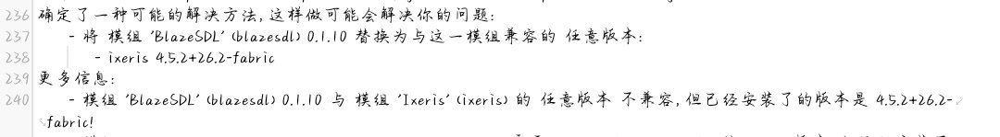
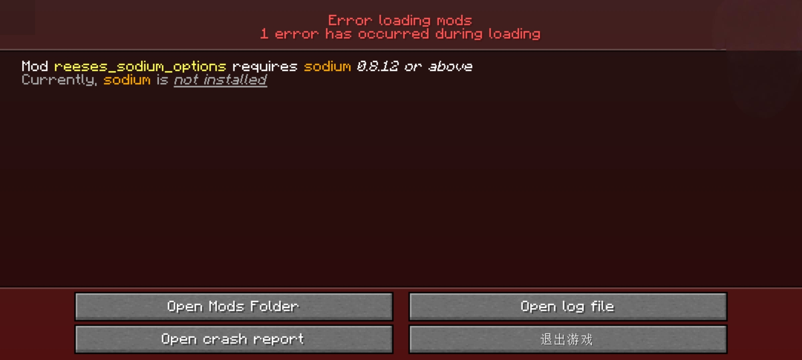

:::tip 专有名词
本文涉及到的专有名词：[模组](window:/term/mod)、[前置模组](window:/term/前置模组)、[日志](window:/term/日志)、[Sodium](window:/term/Sodium)
:::

## 什么是模组不兼容

[模组](window:/term/mod)不兼容是模组之间存在**冲突**，这样的两个（多个）模组不能同时安装。

### 解决步骤：

**1**. 查看[日志](window:/term/日志)，找到存在冲突的模组

**2**. 删除（或禁用）其中的一个模组（保留另一个）  

  示例：根据日志提供的信息，模组BlazeSDL和Ixeris冲突，删除BlazeSDL模组**或**Ixeris模组

**3**. 启动游戏

## 什么是缺少前置模组

部分模组如果要**正常运行**，需要同时安装它的[前置模组](window:/term/前置模组)。

:::tip 

部分模组对前置模组的版本有要求

如果安装的前置模组版本不满足要求游戏也无法正常运行

:::

可能会遇到以下两种情况：

示例1：日志中[报错](window:/term/报错)

示例2：游戏内报错

### 解决步骤

**1**. 根据提示确定缺少的前置模组

  示例1缺少fabric-language-kotlin

  示例2缺少[Sodium](window:/term/Sodium)  

**2**. [下载](window:/term/下载)缺失的模组并安装

  示例1：安装模组fabric-language-kotlin

  示例2：安装模组sodium

:::warning 记得确认下载的版本号

部分Mod在**CurseForge**与**Modrinth**上进度不匹配，可能存在CurseForge上版本新，Modrinth上版本旧之类的情况，这时可能导致诸如附属要求最新版本，去Modrinth下依旧报错之类的情况。
所以**下载前**请确认你所选**版本**符合要求

:::

**3**. 启动游戏

